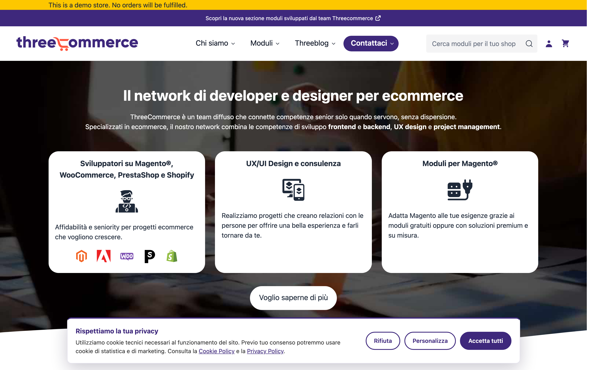
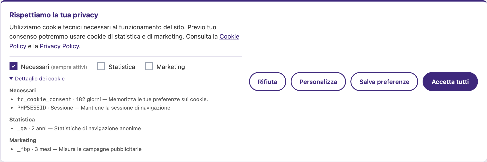
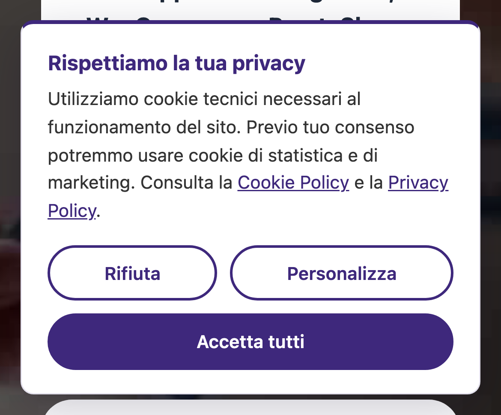
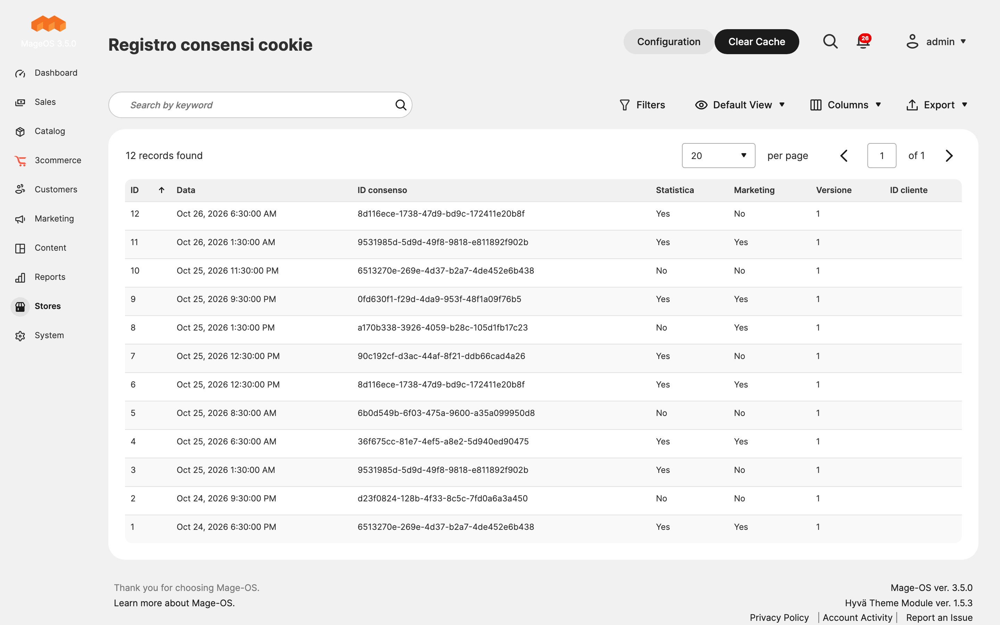
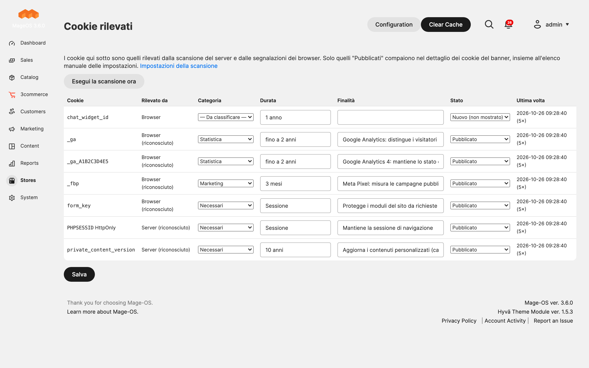

# Threecommerce_CookieBanner: GDPR cookie consent banner for Magento 2 / Mage-OS

Free cookie consent banner for Magento 2 and Mage-OS with three categories (necessary, statistics, marketing), prior blocking of third-party scripts, an optional consent log and an automatic cookie scanner. Self-contained vanilla JavaScript: no RequireJS, no jQuery, no external dependencies.



**Compatibility:** Magento 2.4.x · Mage-OS 3.x · PHP 8.1+ (tested on PHP 8.4) · Themes: Luma, Breeze, Hyvä
**License:** free · **Language:** Italian texts out of the box, editable from the admin · **Current version:** see [Releases](../../releases)

## Features

- Three consent categories: **Necessary** (always on), **Statistics** and **Marketing**, with *Accept all*, *Reject*, *Customize* and *Save preferences* buttons.
- **Prior blocking** of third-party scripts until the visitor gives consent (`type="text/plain"` plus `data-cookiecategory`).
- Consent stored in a first-party cookie, with configurable name, duration and consent version. Raising the version asks everybody for consent again, for example after a policy change.
- Per-category **cookie list** (name, duration, purpose) shown in the preferences panel.
- **Automatic cookie scanner** (cron + browser report): detects the cookies your store really sets, classifies the common ones from a built-in dictionary (Magento, Hyvä, Google, Meta, Microsoft, TikTok, LinkedIn) and lets you review them in the admin.
- Optional **consent log** to prove consent (GDPR art. 7.1): anonymous random ID, choices, consent version, store view and date. Revocations are logged too. Off by default, with automatic purge, admin grid and CSV export.
- Reopen the preferences from any link or button, and a `tc:cookie-consent` DOM event for your own scripts.
- Brand colors from the admin or from CSS variables in your theme.





## Admin





## Requirements

- Magento Open Source 2.4.x, Adobe Commerce or Mage-OS 3.x
- PHP 8.1 or newer

## Installation

The module is distributed through our Composer repository at `repo.threecommerce.it`. Request the credentials from the [product page](https://www.threecommerce.it/cookie-banner-gdpr-magento-2?utm_source=github&utm_medium=readme&utm_campaign=cookie-banner), then:

```bash
composer config repositories.threecommerce composer https://repo.threecommerce.it
composer require threecommerce/m2-cookie-banner
bin/magento module:enable Threecommerce_CookieBanner
bin/magento setup:upgrade
bin/magento cache:flush
```

## Blocking a script until consent

```html
<script type="text/plain" data-cookiecategory="analytics" data-src="https://www.googletagmanager.com/gtag/js?id=G-XXXX"></script>

<script type="text/plain" data-cookiecategory="marketing">
    // runs only after the "marketing" category is accepted
</script>
```

Valid categories: `analytics` and `marketing`. To let visitors change their choice, add `<a href="#cookie-preferences">Cookie preferences</a>` or `<button data-cookie-settings>`, or call `window.TcCookieConsent.open()`.

## Documentation and support

- Product page and user guide (PDF): [threecommerce.it/cookie-banner-gdpr-magento-2](https://www.threecommerce.it/cookie-banner-gdpr-magento-2?utm_source=github&utm_medium=readme&utm_campaign=cookie-banner)
- [Changelog](CHANGELOG.md) (in Italian)
- Support and custom development: [threecommerce.it/contatti](https://www.threecommerce.it/contatti?utm_source=github&utm_medium=readme&utm_campaign=cookie-banner)

The scanner is an aid, not a legal audit: it cannot see third-party cookies set on other domains.

---

*This repository is the public showcase of the module. The source code is kept in a private repository.*
